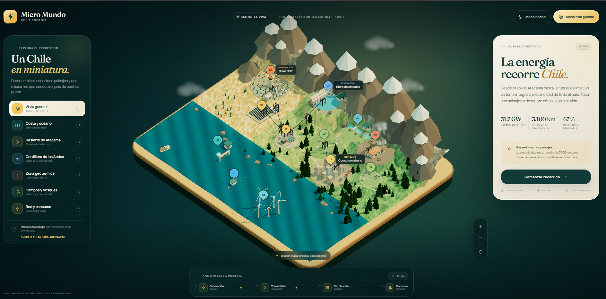

# Micro Mundo de la Energía

Maqueta digital interactiva del Sistema Eléctrico Nacional de Chile, construida con **Astro + Three.js**. El escenario representa en una vista isométrica la cadena eléctrica completa: generación marina, solar, hidráulica, geotérmica y eólica; transmisión de alta tensión; y consumo urbano.


## Ejecutar

```bash
npm install
npm run dev
```

La aplicación queda disponible en `http://localhost:4321`.

```bash
npm run build    # compila la versión de producción
npm run preview  # sirve la compilación
npm run check    # valida TypeScript y archivos Astro
```

## Experiencia

- **Diorama procedural**: océano animado, desierto de Atacama, cordillera nevada, bosques, valle central y borde costero en una sola isla low-poly.
- **12 instalaciones interactivas**: mareomotriz, undimotriz, eólico marino offshore, solar fotovoltaica, CSP con heliostatos, hidroeléctrica de embalse, hidroeléctrica de pasada, geotérmica, eólica terrestre, sistema híbrido, subestación y ciudad.
- **Cadena completa**: la red de transmisión, los flujos de energía y la distribución urbana conectan cada central con el consumo final.
- **Recorrido guiado** de seis etapas, fichas educativas, navegación por zonas, zoom por rueda/pinza, hover y selección 3D.
- **Modo día y noche** con iluminación, estrellas, ventanas y luces urbanas.
- **Diseño responsive** de escritorio a móvil, con panel inferior, selectores horizontales y controles adaptados a pantalla táctil.
- **Accesibilidad**: navegación por teclado, nombres accesibles en marcadores, foco visible, soporte de movimiento reducido y fallback si WebGL no está disponible.

## Estructura

```text
src/
  data/sites.ts             Contenido, zonas y metadatos de las instalaciones
  pages/index.astro         Interfaz, iconografía y estructura editorial
  scripts/app.ts            Estado de la UI, fichas y recorrido guiado
  scripts/three/world.ts    Escena, cámara, marcadores, red eléctrica e interacción
  scripts/three/builders.ts Modelos procedurales de cada instalación
  scripts/three/terrain.ts  Isla, relieve, océano, vegetación y base flotante
  styles/global.css         Sistema visual responsive
```

## Nota educativa

Las potencias, demandas y estados mostrados son **referenciales** y buscan explicar la estructura del sistema eléctrico, no representar una operación en tiempo real. La maqueta está pensada como material educativo interactivo.
